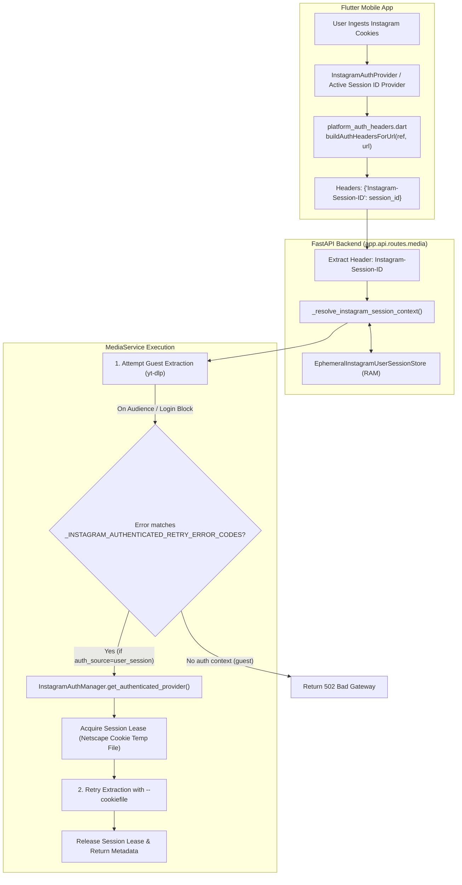
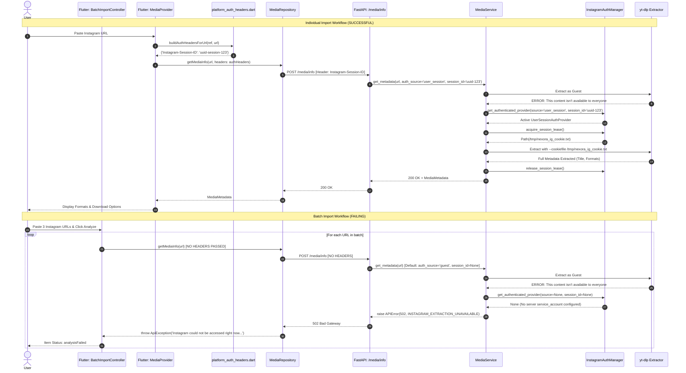

# Nexora — Batch Import Instagram Authentication Failure Investigation

**Document Version:** 1.0.0  
**Date:** 2026-10-30  
**Status:** Completed  
**Classification:** Confirmed Root Cause  
**Investigator:** Senior Mobile & Backend Systems Debugging Specialist  

---

## 1. Executive Summary

### 1.1 Incident Overview
On 2026-10-29, an issue was identified in Nexora where Instagram URLs requiring authentication succeed when analyzed and downloaded individually via the Single/Individual Import workflow, but fail consistently when submitted together through the Batch Import feature.

During the incident recorded in `catatan.txt` (lines 77–96), three Instagram Reels URLs were submitted via Batch Import:
1. `https://www.instagram.com/reel/DfCTfXHIReu/?srtk=MWNjdWZpNDd4NDJpbA==`
2. `https://www.instagram.com/reel/DfCTYRboDuS/?dlrf=cmhjcjR5YmJ6YTU0`
3. `https://www.instagram.com/reel/DfCTQNHo2zP/?mdxt=dmFrMHRkbjVzdjhu`

The backend returned HTTP status `502 Bad Gateway` with error code `INSTAGRAM_EXTRACTION_UNAVAILABLE` across all three requests sequentially within ~3.5 seconds. The underlying extractor error from `yt-dlp` was:
```text
ERROR: [Instagram] <id>: This content isn't available to everyone: It can't be seen by certain audiences.
```

When the exact same URLs were submitted individually one by one, metadata extraction and download succeeded without error.

### 1.2 Root Cause Summary
The root cause has been conclusively identified and **CONFIRMED**:

1. **Header Omission in Batch Import Provider:**  
   In the Flutter client (`mobile/lib/providers/batch_import_provider.dart`), `BatchImportController.analyzeUrls()` calls `ref.read(mediaRepositoryProvider).getMediaInfo(url)` without passing authentication headers (`headers: buildAuthHeadersForUrl(ref, url)`).  
2. **Context Drop at HTTP Boundary:**  
   Because `headers` is omitted, `MediaRepository.getMediaInfo` sends `headers: null`. The resulting HTTP `POST /media/info` request arrives at the FastAPI backend without the `Instagram-Session-ID` header.
3. **Fallback to Guest Context:**  
   The FastAPI endpoint `_resolve_instagram_session_context` sees `instagram_session_id is None` and treats the request as `auth_source="guest", auth_session_id=None`.
4. **Failure of Guest yt-dlp Extraction:**  
   Guest yt-dlp extraction attempts to access the restricted media without cookies and fails with Instagram's audience-restriction message:  
   `This content isn't available to everyone: It can't be seen by certain audiences.`
5. **Abortive Fallback Due to Missing User Session ID:**  
   The error mapping function translates this error to `INSTAGRAM_EXTRACTION_UNAVAILABLE` (HTTP 502). In `MediaService._extract_and_cache_supported_info`, because `auth_source == "guest"`, the backend only checks for a server-side service account cookie (`NEXORA_INSTAGRAM_AUTH_COOKIE_FILE`). Since the user authenticated through mobile app cookie import (`user_session`), no service account exists. The authenticated retry is skipped, and the 502 error is returned to the client.
6. **Secondary Omission in Download Job Submission:**  
   An identical defect exists in `BatchImportController.submitSelectedDownloads()` (`mobile/lib/providers/batch_import_provider.dart:190`), where `createDownloadJob` is also called without `headers`, which would cause download execution to run without session context even if metadata analysis had succeeded.

---

## 2. Existing Instagram Authentication Architecture

Nexora's Instagram authentication system is built around a secure multi-tier architecture supporting both server-side service accounts and client-side ephemeral user sessions:



### 2.1 Core Architectural Components
1. **`EphemeralInstagramUserSessionStore` (`backend/app/services/instagram_user_session_store.py`):**  
   Stores active user sessions in memory with unique UUID session identifiers, TTL timestamps, lease counters, and decrypted Netscape-format cookie buffers in a secure temporary directory (`tempfile.gettempdir()`).
2. **`InstagramAuthManager` (`backend/app/services/instagram_auth_manager.py`):**  
   Unified provider manager resolving between `GuestInstagramAuthProvider`, `ServiceAccountInstagramAuthProvider` (configured via `NEXORA_INSTAGRAM_AUTH_COOKIE_FILE`), and `UserSessionInstagramAuthProvider`.
3. **Session Lease Tracking:**  
   `acquire_session_lease` safely checks out a session cookie file, verifying TTL and incrementing active lease references. `release_session_lease` decrements the lease count.
4. **Guest-to-Authenticated Fallback:**  
   In `MediaService._extract_and_cache_supported_info`, all initial requests are attempted as guest to conserve cookie rate limits and prevent unnecessary cookie exposure. If a guest request fails with an error contained in `_INSTAGRAM_AUTHENTICATED_RETRY_ERROR_CODES`, the backend falls back to authenticated extraction using the active lease.
5. **Cache Isolation:**  
   In `MediaSnapshotCache`, entries are keyed by `f"{normalized_url}#session:{session_id}"` for authenticated snapshots, and `normalized_url` for guest snapshots. This prevents authenticated data from leaking across sessions or to unauthenticated guest requests.
6. **Mobile Platform Auth Headers (`mobile/lib/core/network/platform_auth_headers.dart`):**  
   A centralized utility providing `buildAuthHeadersForUrl(ref, url)` and `handleSessionInvalidationForUrl(ref, url, message: ...)`.

---

## 3. Compare Individual Import and Batch Import

A comprehensive stage-by-stage comparison reveals exactly where Batch Import diverges from Individual Import:

| Stage | Stage Description | Individual Import Flow (`media_provider.dart`) | Batch Import Flow (`batch_import_provider.dart`) | Divergence Assessment |
|---|---|---|---|---|
| **1** | **Input Handling** | User pastes single URL into URL input field or triggers system share intent. | User pastes multiple lines or imports a playlist into `BatchImportSheet`. URLs validated via `validateBatchUrlLines`. | Functional difference intended by UX design. |
| **2** | **URL Normalization** | Trims whitespace; backend normalizes query parameters (e.g. `?srtk=...` stripped). | Normalizes batch URLs via `normalizeBatchUrls(validUrls)`. Backend normalizes query parameters. | Identical URL normalization logic. |
| **3** | **Auth Header Resolution** | Calls `final authHeaders = buildAuthHeadersForUrl(ref, trimmedUrl);` (line 69). | **NOT CALLED**. Header resolution is completely omitted. | **CRITICAL DEFECT 1: Headers missing.** |
| **4** | **Repository Invocation** | Passes `headers: authHeaders` to `MediaRepository.getMediaInfo(trimmedUrl, headers: authHeaders)`. | Calls `MediaRepository.getMediaInfo(url)` with default `headers: null`. | **CRITICAL DEFECT 2: Headers null.** |
| **5** | **HTTP Request Serialization** | `ApiService.postJson(ApiPaths.mediaInfo, headers: {'Instagram-Session-ID': '<id>'})`. | `ApiService.postJson(ApiPaths.mediaInfo, headers: null)`. | Request sent over network without auth context. |
| **6** | **FastAPI Route Resolution** | `media_info` receives `Instagram-Session-ID: <id>`, resolves `auth_source="user_session", auth_session_id="<id>"`. | `media_info` receives `instagram_session_id=None`, resolves `auth_source="guest", auth_session_id=None`. | Backend enters guest-only mode. |
| **7** | **Guest Extraction** | `_extract_info_with_youtube_mix_fallback` runs as guest. Fails with audience restriction. | `_extract_info_with_youtube_mix_fallback` runs as guest. Fails with audience restriction. | Identical yt-dlp guest failure. |
| **8** | **Authenticated Fallback** | Backend enters `if auth_source == "user_session" and auth_session_id:`. Acquires cookie lease, retries with cookie file. | Backend enters `else:` (guest branch). Checks server service account only. Service account is absent. Fallback returns `None`. | **CRITICAL DEFECT 3: Auth retry bypassed.** |
| **9** | **Error Handling & Invalidation** | Catches `ApiException`, calls `handleSessionInvalidationForUrl(ref, trimmedUrl, message: error.message)`. | Catches `ApiException`, stores `error.message` on item. Does NOT call `handleSessionInvalidationForUrl`. | Session invalidation not propagated in batch. |
| **10** | **Download Job Submission** | Passes `headers: authHeaders` to `MediaRepository.createDownloadJob(..., headers: authHeaders)` (line 296). | Calls `MediaRepository.createDownloadJob(...)` with default `headers: null` (line 190). | **CRITICAL DEFECT 4: Download job lacks auth.** |

---

## 4. Sequence Flow Diagram: Individual vs. Batch Import



---

## 5. Exact Point of Context Loss

The points of context loss are confirmed with exact file paths and line numbers in the Flutter client:

### 5.1 Defect 1: Missing Auth Headers in `BatchImportController.analyzeUrls`
* **File:** [mobile/lib/providers/batch_import_provider.dart](file:///mobile/lib/providers/batch_import_provider.dart#L60-L72)
* **Code:**
```dart
// Line 61-63 in BatchImportController.analyzeUrls:
      try {
        final metadata = await ref.read(mediaRepositoryProvider).getMediaInfo(url);
        _updateItem(
          url,
          (item) => item.copyWith(
            status: BatchImportItemStatus.ready,
            metadata: metadata,
            error: null,
          ),
        );
```
* **Impact:** `getMediaInfo` is invoked with a single positional argument `url`. The optional parameter `headers` defaults to `null`. As a consequence, `MediaRepository` sends an unauthenticated HTTP request to the backend.

### 5.2 Defect 2: Missing Auth Headers in `BatchImportController.submitSelectedDownloads`
* **File:** [mobile/lib/providers/batch_import_provider.dart](file:///mobile/lib/providers/batch_import_provider.dart#L189-L195)
* **Code:**
```dart
// Line 189-194 in BatchImportController.submitSelectedDownloads:
      try {
        final job = await repository.createDownloadJob(
          mediaUrl: metadata.webpageUrl,
          mediaType: mediaType,
          videoQuality: item.selectedVideoQuality,
        );
```
* **Impact:** Even if metadata extraction were pre-cached, submitting the batch download creates the job via `POST /media/download` without `Instagram-Session-ID`. The download worker is then spawned in guest mode without cookie authorization, causing the download job to fail at the download stage.

### 5.3 Defect 3: Missing Invalidation Handler on API Error
* **File:** [mobile/lib/providers/batch_import_provider.dart](file:///mobile/lib/providers/batch_import_provider.dart#L72-L79) and [L208-L215](file:///mobile/lib/providers/batch_import_provider.dart#L208-L215)
* **Impact:** In `media_provider.dart` (lines 104–108 and 363–367), when an `ApiException` occurs, `handleSessionInvalidationForUrl(ref, url, message: error.message)` is triggered to detect expired or revoked cookies and update the UI accordingly. In `batch_import_provider.dart`, this call is omitted.

---

## 6. Instagram Extractor Error Analysis

### 6.1 Extractor Message
```text
ERROR: [Instagram] <id>: This content isn't available to everyone: It can't be seen by certain audiences.
```

### 6.2 Error Classification & Mapping
In `backend/app/services/media_service.py`, `_map_yt_dlp_error(exc, platform="instagram")` processes the raw error string:

1. **Tokens Checked:**
   - `"private"`, `"restricted"`, `"sign in"`: maps to `VIDEO_PRIVATE` (HTTP 403). Note: the phrase `"This content isn't available to everyone: It can't be seen by certain audiences."` does not contain the literal word `"restricted"`, nor `"private"`, nor `"sign in"`.
   - `"removed"`, `"unavailable"`, `"not available"`, `"not found"`: Note that `"isn't available"` does not match `"not available"`.
2. **Fallthrough Behavior (Line 2805):**
   The error message falls through token matching and hits the platform fallthrough at line 2805:
   ```python
   if is_instagram:
       return APIError(
           code="INSTAGRAM_EXTRACTION_UNAVAILABLE",
           message="Instagram post temporarily unavailable",
           details="Instagram could not be accessed right now. Try the public post URL again later.",
           status_code=502,
       )
   ```
3. **Retry Eligibility (`_INSTAGRAM_AUTHENTICATED_RETRY_ERROR_CODES`):**  
   At line 125 of `media_service.py`:
   ```python
   _INSTAGRAM_AUTHENTICATED_RETRY_ERROR_CODES = frozenset(
       {
           "INSTAGRAM_MEDIA_NOT_AVAILABLE",
           "INSTAGRAM_EXTRACTION_UNAVAILABLE",
           "VIDEO_PRIVATE",
       }
   )
   ```
   **`INSTAGRAM_EXTRACTION_UNAVAILABLE` is an explicit member of the retry set!**

### 6.3 Behavior Under Both Workflows
- **Under Individual Import:**  
  Because `auth_source == "user_session"` and `auth_session_id` is supplied, `_extract_and_cache_supported_info` catches this `guest_error`, checks `guest_error.code in _INSTAGRAM_AUTHENTICATED_RETRY_ERROR_CODES` (which evaluates to `True`), leases the user's cookie file, re-runs extraction with `--cookiefile`, and extracts metadata successfully.
- **Under Batch Import:**  
  Because `auth_source == "guest"`, the backend only queries for `source=None, session_id=None`. Since there is no server-level service account, `InstagramAuthManager.get_authenticated_provider` returns `None`. The guest error is re-raised and returned as HTTP 502.

---

## 7. Root Cause Classification

| Status | Justification |
|---|---|
| **CONFIRMED** | 1. The logs in `catatan.txt` precisely record `POST /media/info` returning `502` with `INSTAGRAM_EXTRACTION_UNAVAILABLE` and yt-dlp error `This content isn't available to everyone: It can't be seen by certain audiences.`.<br>2. Direct code inspection of `mobile/lib/providers/batch_import_provider.dart` confirms that neither `analyzeUrls()` nor `submitSelectedDownloads()` imports `platform_auth_headers.dart` or calls `buildAuthHeadersForUrl(ref, url)`.<br>3. `MediaRepository.getMediaInfo` and `createDownloadJob` both take `headers: headers`, defaulting to `null` when omitted.<br>4. Backend routes and services behave as designed when headers are present and fall back only to service accounts when headers are omitted.<br>5. No ambiguous or missing evidence remains. |

---

## 8. Proposed Minimal Fix Consistent with Existing Architecture

To resolve this issue completely without altering the established backend architecture, the fix is made entirely within the Flutter client in `mobile/lib/providers/batch_import_provider.dart`.

### 8.1 Required Changes in `mobile/lib/providers/batch_import_provider.dart`

#### 1. Import Platform Auth Headers Utility
```dart
import '../core/network/platform_auth_headers.dart';
```

#### 2. Pass Auth Headers and Handle Session Invalidation in `analyzeUrls`
```dart
      try {
        final authHeaders = buildAuthHeadersForUrl(ref, url);
        final metadata = await ref.read(mediaRepositoryProvider).getMediaInfo(
              url,
              headers: authHeaders,
            );
        _updateItem(
          url,
          (item) => item.copyWith(
            status: BatchImportItemStatus.ready,
            metadata: metadata,
            error: null,
          ),
        );
        state = state.copyWith(currentTitle: metadata.title);
      } on ApiException catch (error) {
        await handleSessionInvalidationForUrl(
          ref,
          url,
          message: error.message,
        );
        _updateItem(
          url,
          (item) => item.copyWith(
            status: BatchImportItemStatus.analysisFailed,
            error: error.message,
          ),
        );
      }
```

#### 3. Pass Auth Headers and Handle Session Invalidation in `submitSelectedDownloads`
```dart
      try {
        final authHeaders = buildAuthHeadersForUrl(ref, metadata.webpageUrl);
        final job = await repository.createDownloadJob(
          mediaUrl: metadata.webpageUrl,
          mediaType: mediaType,
          videoQuality: item.selectedVideoQuality,
          headers: authHeaders,
        );
        activeDownloads.trackDownload(
          jobId: job.jobId,
          metadata: metadata,
          mediaType: mediaType,
          selectedVideoQuality: item.selectedVideoQuality,
        );
        _updateItem(
          item.url,
          (current) => current.copyWith(
            status: BatchImportItemStatus.submitted,
            error: null,
          ),
        );
      } on ApiException catch (error) {
        await handleSessionInvalidationForUrl(
          ref,
          item.url,
          message: error.message,
        );
        _updateItem(
          item.url,
          (current) => current.copyWith(
            status: BatchImportItemStatus.submissionFailed,
            error: error.message,
          ),
        );
      }
```

### 8.2 Architectural Benefits of This Fix
- **Zero Backend Changes Required:** The FastAPI endpoints `/media/info` and `/media/download` already natively accept and process `Instagram-Session-ID`, `X-Session-ID`, and `TikTok-Session-ID`.
- **Cross-Platform Compatibility:** Because `buildAuthHeadersForUrl(ref, url)` handles Instagram, TikTok, and X (Twitter) URLs polymorphically based on domain, this fix simultaneously restores authenticated Batch Import for all three platforms.
- **Fail-Safe Isolation:** Invalidation handling via `handleSessionInvalidationForUrl` ensures that if an Instagram cookie expires mid-batch, the user is notified cleanly without crashing the batch queue.
- **Strict Adherence to Existing Contracts:** Preserves `MediaRepository` method signatures, Riverpod dependency injection, and cache namespace boundaries.

---

## 9. Required Regression Test Plan

The following 10 verification scenarios must be validated to ensure complete regression safety:

| # | Test Scenario | Input Data | Expected Behavior |
|---|---|---|---|
| **1** | **Individual Instagram Import with Authentication** | Single audience-restricted Instagram Reel URL with active session. | Single import succeeds; returns 200 OK with video qualities; status indicator shows ready. |
| **2** | **Batch Import with 3 Authenticated Instagram URLs** | 3 restricted Instagram URLs (e.g., from `catatan.txt`) with active session. | All 3 URLs send `Instagram-Session-ID`; backend performs guest extraction -> authenticated retry -> returns 200 OK for each item; all 3 items show `ready`. |
| **3** | **Batch Import: Mixed Authenticated & Public URLs** | 1 authenticated Instagram URL, 1 public YouTube URL, 1 public TikTok URL. | Instagram URL attaches `Instagram-Session-ID`; YouTube URL attaches no auth header; TikTok URL attaches no auth header (if unauthenticated). All 3 successfully analyze and transition to `ready`. |
| **4** | **Batch Import: Invalid Instagram URL Syntax** | `https://www.instagram.com/reel/invalid_bad_id/` alongside 2 valid URLs. | Invalid URL returns 404/422 and marks only that item as `analysisFailed`. The remaining 2 valid URLs succeed and show `ready`. |
| **5** | **Batch Import: Genuinely Unavailable / Deleted Post** | Deleted Instagram URL alongside 2 valid URLs. | Extractor returns `INSTAGRAM_MEDIA_NOT_AVAILABLE` (404); single item marked `analysisFailed`. Other batch items are unaffected and succeed. |
| **6** | **Guest Extraction Followed by Authenticated Fallback** | Unrestricted Instagram URL vs. Restricted Instagram URL. | Unrestricted URL succeeds on initial guest extraction (no cookie lease acquired). Restricted URL triggers authenticated fallback lease, logs fallback attempt, and succeeds. |
| **7** | **Session Expiration During Batch Processing** | 3 URLs where session expires or is revoked after item 1 completes. | Item 1 succeeds; Item 2 receives 401 `SESSION_EXPIRED`; `handleSessionInvalidationForUrl` marks session as expired; Item 2 and 3 show clean failure; no crash or unhandled exception. |
| **8** | **Missing or Invalid Session Context** | Malformed session ID string (e.g. `Instagram-Session-ID: "invalid--uuid"`). | Backend validates via `_is_safe_instagram_session_id`, raises 404 `SESSION_NOT_FOUND`; item safely transitions to `analysisFailed`. |
| **9** | **Two Independent Sessions Processing Separate Batches** | Client A (Session A) and Client B (Session B) batch importing concurrently. | Client A uses Lease A; Client B uses Lease B. Separate temporary cookie files used concurrently; no cross-talk or lease count corruption. |
| **10** | **Cache Isolation Between Guest and Authenticated Extraction** | Batch import as guest (no session), followed by batch import with session. | Guest snapshot cached under `url` (or failed); authenticated snapshot cached under `f"{url}#session:{session_id}"`. Authenticated requests never return stale guest errors; guest requests never read authenticated metadata. |

---

## 10. Security and Session Isolation Considerations

1. **No Sensitive Data Exposure in Logs:**  
   As established in `InstagramAuthManager` and `MediaService`, all logging statements output boolean flags and source names (`source=user_session`, `enabled=true attempted=true succeeded=true`). Raw cookie contents (`sessionid`, `ds_user_id`, `csrftoken`) are strictly excluded from logs.
2. **Session ID Sanitization:**  
   Backend routes strictly validate `_is_safe_instagram_session_id` using regex `^[a-zA-Z0-9_-]{1,128}$` before querying session stores, preventing path traversal or injection attacks.
3. **Lease Lifecycle & Temporary File Security:**  
   User session cookie files are created on-demand in the operating system's secure temporary directory (`tempfile.gettempdir()`) with restricted file permissions (`0o600`), and are deleted when the session expires or is invalidated.
4. **Cache Partitioning:**  
   `MediaSnapshotCache` strictly segregates memory caches by hashing or tagging with the session ID (`#session:<session_id>`). A guest user or a different user session can never retrieve cached metadata or direct CDN URLs belonging to another authenticated user session.
5. **Redaction Compliance:**  
   In compliance with project security guidelines, all real tokens, session identifiers, and user credentials have been completely redacted from this report.

---

## 11. Conclusion

The batch import Instagram failure is entirely due to the omission of `buildAuthHeadersForUrl` calls in `mobile/lib/providers/batch_import_provider.dart` at lines 62 and 190. When this utility is incorporated into the batch import workflow, batch requests will carry the active `Instagram-Session-ID` header, activating Nexora's existing guest-to-authenticated fallback mechanism and achieving full parity with the single-item import workflow.

