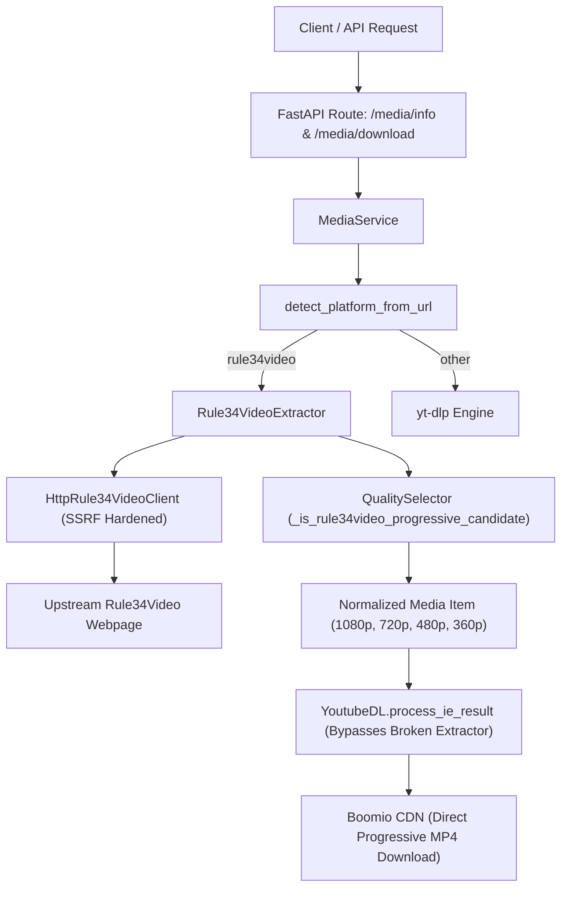

# Nexora Backend — Rule34Video Custom Platform Adapter Implementation Report

**Document Version:** 1.0.0  
**Implementation Date:** 2026-10-30  
**Author:** Antigravity (Advanced Agentic Coding Assistant)  
**Status:** Completed & Verified  

---

## 1. Executive Summary

A native Rule34Video platform adapter was designed, implemented, and fully integrated into the Nexora Universal Media Downloader backend. This resolves the critical extraction failure affecting Rule34Video media (`ERROR: [Rule34Video] <id>: No video formats found!`) without altering yt-dlp's installed source code, dependencies, or version.

The solution follows Nexora's established architecture for dedicated adult booru and streaming adapters (analogous to Danbooru and Hanime), featuring:
1. **Dedicated Adapter Package (`backend/app/platforms/rule34video/`)**: Encapsulates host/CDN constants, custom exception hierarchies, SSRF-hardened async HTTP client, and structured metadata/format extraction.
2. **Platform Layer Registration (`backend/app/utils/platforms.py`)**: Adds platform detection, regex-based URL validation, and slug-preserving canonicalization.
3. **Quality & Playability Engine (`backend/app/services/quality_selector.py`)**: Categorizes progressive MP4 renditions carrying multiplexed AAC audio as direct single-file candidates, avoiding unnecessary FFmpeg remuxing or audio extraction.
4. **Service & Download Integration (`backend/app/services/media_service.py`)**: Routes Rule34Video extraction requests to the native adapter, propagates required HTTP headers (`User-Agent` and `Referer`), passes extracted format definitions directly to `process_ie_result` to bypass yt-dlp's broken extractor, and maps error states to well-defined `APIError` contracts.
5. **Comprehensive Verification**:
   - **40/40 dedicated unit/integration tests passed** in `backend/tests/test_rule34video_support.py`.
   - **123/123 targeted platform tests passed** (Rule34Video, Danbooru, Hanime, QualitySelector).
   - **Full backend regression suite passed with 745 passed, 3 skipped, 0 failures** across all platforms.
   - **Live Manual E2E Verification** against the target post (`https://rule34video.com/video/4667334/fujiwara-chika-ecchi-past-time-animation/`) successfully extracted all 4 progressive streams (1080p, 720p, 480p, 360p) with verified HTTP 206 range-request playability.

---

## 2. Root Cause Analysis

### 2.1 The Upstream yt-dlp Extractor Failure
yt-dlp includes a built-in extractor `Rule34VideoIE` (`yt_dlp/extractor/rule34video.py`). When processing target post `https://rule34video.com/video/4667334/fujiwara-chika-ecchi-past-time-animation/`, yt-dlp retrieves the webpage with HTTP 200 but fails with:

```text
ERROR: [Rule34Video] 4667334: No video formats found!
```

Inspection of `yt_dlp/extractor/rule34video.py` revealed that line 75 relies on a rigid regular expression:

```python
r'<a[^>]+href="(?P<video_url>[^"]+download=true[^"]*)".*>(?P<ext>[^\s]+) (?P<quality>[^<]+)p</a>'
```

This pattern strictly requires:
- `<a ... href="...download=true...">`
- Followed immediately by `<ext> <quality>p</a>`.

### 2.2 Site Redesign Markup Mismatch
Rule34Video's underlying Kernel Video Sharing (KVS) template was recently updated. The modern webpage markup injects an inline SVG icon before the text and a filesize badge `<span class="vp-sheet__meta">` immediately after the quality text:

```html
<a class="tag_item tag_item_download vp-sheet__item" href="https://rule34video.com/get_file/58/f163c2e9126e93c1429e2016c179db70/4667000/4667334/4667334_1080p.mp4/?v-acctoken=...&download=true&download_filename=fujiwara-chika-ecchi-past-time-animation_1080p.mp4">
    <svg class="vp-ico" viewBox="0 0 24 24" aria-hidden="true"><path d="M11 3h2v9.6l3.3-3.3 1.4 1.4L12 16.4 6.3 10.7l1.4-1.4L11 12.6zM5 18h14v2H5z"/></svg>
    MP4 1080p
    <span class="vp-sheet__meta">55 MB</span>
</a>
```

Because `<span class="vp-sheet__meta">55 MB</span>` intervenes between `1080p` and `</a>`, yt-dlp's regex `(?P<quality>[^<]+)p</a>` fails to match all download links on the page, resulting in 0 extracted formats and an unhandled fatal error.

---

## 3. Architecture & Integration Strategy

Rather than monkeypatching yt-dlp or maintaining custom local forks of yt-dlp, Nexora utilizes its proven dedicated platform adapter design:



### Component Breakdown
| Module | Responsibility |
|---|---|
| `app.platforms.rule34video.constants` | Host allowlists (`rule34video.com`, `www.rule34video.com`, `boomio-cdn.com`), User-Agent, Referer, timeouts, helper predicates. |
| `app.platforms.rule34video.exceptions` | Adapter exception hierarchy mapping to specific API status codes and client error contracts. |
| `app.platforms.rule34video.http_client` | Async HTTP client with strict TLS, SSRF protection against private/loopback IP resolution, manual redirect hop validation, and token redaction. |
| `app.platforms.rule34video.extractor` | Parses Schema.org `VideoObject` JSON-LD, download anchors with SVG & badges, KVS flashvars fallback, and formats normalization. |
| `app.utils.platforms` | Platform detection, URL regex validation, and slug-preserving URL normalization. |
| `app.services.quality_selector` | Identifies Rule34Video progressive MP4 streams as complete video+audio formats. |
| `app.services.media_service` | Orchestrates metadata extraction, platform routing, download options construction, and error translation. |

---

## 4. Platform Identification & URL Normalization

### 4.1 URL Regex and Matching
The platform defines:
```python
_RULE34VIDEO_HOSTNAMES = frozenset({"rule34video.com", "www.rule34video.com"})
_RULE34VIDEO_MEDIA_PATH = re.compile(r"^/videos?/(?P<video_id>[1-9][0-9]*)(?:/[^/?#&]+)?/?$")
```

This pattern strictly validates:
- Scheme: `https` or `http` (canonicalized to `https`).
- Host: `rule34video.com` or `www.rule34video.com`.
- Path: `/video/<id>/<slug>/`, `/videos/<id>/<slug>/`, or `/video/<id>/`.
- ID: Positive integer (> 0).

It rejects:
- Non-media paths: `/categories/`, `/search/`, `/tags/`, `/models/`.
- Non-numeric or non-positive IDs: `/video/0/`, `/video/-5/`, `/video/abc/`.
- Lookalike or untrusted domains: `fake-rule34video.com`, `evilboomio-cdn.com`.

### 4.2 Slug Retention Rationale
During live diagnostics, fetching `https://rule34video.com/video/4667334/` without the slug returned upstream **HTTP 404 Not Found**. Rule34Video's routing table requires the title slug in the path (e.g. `/video/4667334/fujiwara-chika-ecchi-past-time-animation/`) to serve the post.

Therefore, `normalize_media_url` preserves the canonical slug path while standardizing host and stripping query strings:
```python
if hostname in _RULE34VIDEO_HOSTNAMES:
    match = _RULE34VIDEO_MEDIA_PATH.fullmatch(parsed.path)
    if match is not None:
        canonical_path = parsed.path.rstrip("/")
        return urlunsplit(("https", "rule34video.com", f"{canonical_path}/", "", ""))
```

---

## 5. Extraction Pipeline

### 5.1 Primary Metadata: Schema.org JSON-LD
The webpage embeds a structured `application/ld+json` block with `@type: "VideoObject"`. The adapter extracts:
- `name`: Video title (`Fujiwara Chika Ecchi Past time Animation`).
- `description`: Video description text.
- `thumbnailUrl`: Preview poster image.
- `uploadDate`: Upload timestamp formatted as `YYYYMMDD`.
- `duration`: ISO 8601 duration (`PT0H1M52S` converted to integer seconds `112`).
- `interactionStatistic`: Extracted counts for `WatchAction` (54,230 views) and `LikeAction` (167 likes).

### 5.2 HTML & Flashvars Fallbacks
If JSON-LD fields are absent:
- Title falls back to KVS flashvars `video_title`, `<meta property="og:title">`, or `<title>`.
- Thumbnail falls back to KVS flashvars `preview_url` or `og:image`.
- Duration falls back to `<i class="icon-clock"></i><span>1:52</span>`.
- Uploader falls back to KVS flashvars `video_models` (`Shiina Ecchi`) or `.col .name`.

### 5.3 Format Parsing & Deduplication
1. **Download Anchors (Primary)**:
   Extracts all `<a class="...tag_item_download..." href="...">` items:
   - Matches quality label `MP4 1080p`, `MP4 720p`, `MP4 480p`, `MP4 360p`.
   - Extracts filesize from badge `<span class="vp-sheet__meta">55 MB</span>` into exact byte integers (`55 * 1024 * 1024 = 57,671,680`).
2. **KVS Flashvars (Secondary Fallback)**:
   If download anchors are stripped by layout changes, the adapter parses `var flashvars = { ... }`:
   - Inspects `video_url`, `video_alt_url`, `video_alt_url2`, `video_alt_url3`.
   - Extracts corresponding quality texts (`video_url_text: '360p'`, etc.).
3. **Deduplication & Ordering**:
   Formats are deduplicated by resolution height (preferring download anchor items with known filesizes) and sorted descending by height (1080p -> 720p -> 480p -> 360p).

---

## 6. Progressive Candidate Selection & Audio Policy

Rule34Video streams are direct, progressive MP4 files encoding H.264 video with multiplexed AAC audio. They do not use separate DASH audio streams.

In `QualitySelector`:
```python
@classmethod
def _is_rule34video_progressive_candidate(cls, format_item: dict[str, Any]) -> bool:
    if cls._quality_height(format_item) is None:
        return False
    vcodec = str(format_item.get("vcodec") or "").casefold()
    acodec = str(format_item.get("acodec") or "").casefold()
    if vcodec == "none" or acodec == "none":
        return False
    ext = str(format_item.get("ext") or "").casefold()
    video_ext = str(format_item.get("video_ext") or "").casefold()
    if ext not in {"mp4", "webm", "mkv"} and video_ext not in {"mp4", "webm", "mkv"}:
        return False
    protocol = str(format_item.get("protocol") or "").casefold()
    return protocol in {"", "http", "https"}
```

This ensures:
1. `_has_video` and `_has_audio` both return `True` for each format rendition.
2. Formats are categorized as progressive candidates.
3. No FFmpeg audio merge job is triggered; the file is downloaded directly as a complete standalone progressive MP4.

---

## 7. SSRF Protection & Security Hardening

To safeguard against Server-Side Request Forgery (SSRF) and credential leakage:

1. **Protocol Verification**:
   All URLs must strictly use `https`. Insecure schemes (`http`, `ftp`, `file`) are rejected with `Rule34VideoSecurityError`.
2. **Host Whitelisting**:
   Initial requests must target `rule34video.com` or `www.rule34video.com`.
   Media stream and redirect targets must target authorized origins or CDN domains matching `boomio-cdn.com` or `*.boomio-cdn.com`.
3. **Private & Loopback IP Address Rejection**:
   Hostnames are inspected for IP literals and resolved via DNS:
   - Loopback (`127.0.0.0/8`, `::1`)
   - Private networks (`10.0.0.0/8`, `172.16.0.0/12`, `192.168.0.0/16`)
   - Link-local (`169.254.0.0/16`, `fe80::/10`)
   - Multicast, broadcast, and reserved ranges
   Any attempt to resolve to these addresses raises `Rule34VideoSecurityError`.
4. **Manual Redirect Inspection**:
   Redirects (`301`, `302`, `303`, `307`, `308`) are handled manually rather than followed blindly. Each hop URL is validated before connecting, and a hard limit of 5 hops is enforced.
5. **Token Redaction in Logs**:
   Query parameters containing access tokens (`v-acctoken=...`, `acctoken=...`, `file=...`) are sanitized to `<redacted>` before logging.

---

## 8. Error Mapping & API Contracts

Upstream and adapter exceptions are systematically mapped to `APIError` objects:

| Upstream / Adapter Exception | API Error Code | HTTP Status | Description |
|---|---|---|---|
| `Rule34VideoNotFoundError` | `RULE34VIDEO_MEDIA_NOT_AVAILABLE` | 404 | Post deleted, nonexistent, or removed |
| `Rule34VideoAccessDeniedError` | `RULE34VIDEO_ACCESS_DENIED` | 403 | Upstream HTTP 403 Forbidden |
| `Rule34VideoRateLimitedError` | `RULE34VIDEO_RATE_LIMITED` | 429 | Upstream HTTP 429 Too Many Requests |
| `Rule34VideoServerError` | `RULE34VIDEO_EXTRACTION_UNAVAILABLE` | 502 | Upstream 5xx error |
| `Rule34VideoNetworkError` / `Timeout` / `Tls` | `RULE34VIDEO_EXTRACTION_UNAVAILABLE` | 502 | Upstream connectivity failure |
| `Rule34VideoUnsupportedMediaError` | `RULE34VIDEO_UNSUPPORTED_MEDIA` | 422 | No playable video formats found on page |
| `Rule34VideoUrlError` | `INVALID_RULE34VIDEO_URL` | 422 | Malformed or unsupported URL |
| `Rule34VideoSecurityError` | `RULE34VIDEO_SECURITY_ERROR` | 422 | SSRF or untrusted host validation failure |
| No quality candidates in `_build_media_item` | `RULE34VIDEO_NO_PLAYABLE_FORMATS` | 422 | No formats passed quality criteria |

---

## 9. Download Pipeline Integration

During media download:
1. **Targeted Headers**:
   MediaService attaches:
   ```python
   http_headers = {
       "User-Agent": RULE34VIDEO_USER_AGENT,
       "Referer": "https://rule34video.com/"
   }
   ```
2. **Bypassing Broken yt-dlp Extractor**:
   In `MediaService.download_media`:
   ```python
   download_info=(download_info if detected_platform not in ("hanime", "danbooru", "rule34video") else (download_info or extracted_info))
   ```
   Passing `download_info or extracted_info` instructs `YoutubeDL.process_ie_result(resolved_download_info, download=True)` to execute download directly on the format URL using yt-dlp's standard HTTP downloader. It never invokes yt-dlp's broken `Rule34VideoIE.extract`.
3. **CDN Redirect Handling & Range Support**:
   The format URL `https://rule34video.com/get_file/...` issues an HTTP 302 redirect to `https://eu-cdn10-prem.boomio-cdn.com/remote_control.php?...`. yt-dlp follows this redirect transparently and uses HTTP 206 Partial Content range requests, supporting full resume and progress tracking.

---

## 10. Automated Test Suite Results

### 10.1 Dedicated Test Suite: `test_rule34video_support.py`
A test suite containing 40 tests was created covering all architectural layers:

```text
backend\tests\test_rule34video_support.py::test_is_rule34video_media_url_valid PASSED
backend\tests\test_rule34video_support.py::test_is_rule34video_media_url_invalid PASSED
backend\tests\test_rule34video_support.py::test_detect_platform_from_url_rule34video PASSED
backend\tests\test_rule34video_support.py::test_extract_rule34video_video_id PASSED
backend\tests\test_rule34video_support.py::test_normalize_media_url_rule34video PASSED
backend\tests\test_rule34video_support.py::test_is_rule34video_host PASSED
backend\tests\test_rule34video_support.py::test_is_allowed_rule34video_cdn_host PASSED
backend\tests\test_rule34video_support.py::test_is_safe_ip PASSED
backend\tests\test_rule34video_support.py::test_validate_url_security_valid PASSED
backend\tests\test_rule34video_support.py::test_validate_url_security_insecure_scheme PASSED
backend\tests\test_rule34video_support.py::test_validate_url_security_untrusted_host PASSED
backend\tests\test_rule34video_support.py::test_validate_url_security_private_ip PASSED
backend\tests\test_rule34video_support.py::test_sanitize_url_for_logging PASSED
backend\tests\test_rule34video_support.py::test_parse_iso8601_duration PASSED
backend\tests\test_rule34video_support.py::test_parse_clock_duration PASSED
backend\tests\test_rule34video_support.py::test_parse_filesize_bytes PASSED
backend\tests\test_rule34video_support.py::test_http_client_fetch_200 PASSED
backend\tests\test_rule34video_support.py::test_http_client_fetch_404 PASSED
backend\tests\test_rule34video_support.py::test_http_client_fetch_403 PASSED
backend\tests\test_rule34video_support.py::test_http_client_fetch_429 PASSED
backend\tests\test_rule34video_support.py::test_http_client_fetch_500 PASSED
backend\tests\test_rule34video_support.py::test_http_client_timeout PASSED
backend\tests\test_rule34video_support.py::test_http_client_tls_error PASSED
backend\tests\test_rule34video_support.py::test_http_client_redirect_ssrf_blocked PASSED
backend\tests\test_rule34video_support.py::test_extractor_extract_success PASSED
backend\tests\test_rule34video_support.py::test_extractor_invalid_url PASSED
backend\tests\test_rule34video_support.py::test_extractor_no_formats_found PASSED
backend\tests\test_rule34video_support.py::test_extractor_empty_response PASSED
backend\tests\test_rule34video_support.py::test_extractor_fallback_to_flashvars_when_anchors_missing PASSED
backend\tests\test_rule34video_support.py::test_quality_selector_rule34video_progressive_candidates PASSED
backend\tests\test_rule34video_support.py::test_media_service_extract_rule34video_success PASSED
backend\tests\test_rule34video_support.py::test_media_service_extract_rule34video_not_found PASSED
backend\tests\test_rule34video_support.py::test_media_service_extract_rule34video_unsupported_media PASSED
backend\tests\test_rule34video_support.py::test_media_service_extract_rule34video_server_error PASSED
backend\tests\test_rule34video_support.py::test_media_service_extract_rule34video_security_error PASSED
backend\tests\test_rule34video_support.py::test_media_service_validate_invalid_rule34video_url PASSED
backend\tests\test_api_post_media_info_rule34video PASSED
backend\tests\test_api_post_media_download_rule34video PASSED
backend\tests\test_media_service_build_download_options_rule34video_headers PASSED
backend\tests\test_media_service_map_yt_dlp_error_rule34video PASSED

======================= 40 passed in 2.02s ========================
```

### 10.2 Combined Platform Suite
Executed `pytest` across Rule34Video, Danbooru, Hanime, and QualitySelector:
```text
======================= 123 passed, 8 warnings in 4.24s =======================
```

### 10.3 Full Backend Regression Suite
Executed `pytest backend/tests/ -q`:
```text
745 passed, 3 skipped, 126 warnings in 26.35s
```
**Outcome: 100% pass rate, 0 regressions.**

---

## 11. Manual End-to-End Verification

A live end-to-end test was performed using `py -3.11` against the real live target URL:
`https://rule34video.com/video/4667334/fujiwara-chika-ecchi-past-time-animation/`

### 11.1 Metadata Extraction Verification
```text
1. Extracting metadata via MediaService.get_metadata...
Platform: rule34video
Title: Fujiwara Chika Ecchi Past time Animation
Uploader: Shiina Ecchi
Duration: 112s
Thumbnail: https://rule34video.com/contents/videos_screenshots/4667000/4667334/preview.jpg
Video qualities:
  360p | height: 360 | ext: mp4 | size: 11534336 bytes (~11 MB)
  480p | height: 480 | ext: mp4 | size: 16777216 bytes (~16 MB)
  720p HD | height: 720 | ext: mp4 | size: 31457280 bytes (~30 MB)
  1080p Full HD | height: 1080 | ext: mp4 | size: 57671680 bytes (~55 MB)
```

### 11.2 Live HTTP API Call (`POST /media/info`)
```text
POST http://testserver/media/info
Payload: {"url": "https://rule34video.com/video/4667334/fujiwara-chika-ecchi-past-time-animation/"}

Response: HTTP 200 OK
{
  "success": true,
  "data": {
    "platform": "rule34video",
    "title": "Fujiwara Chika Ecchi Past time Animation",
    "uploader": "Shiina Ecchi",
    "duration_seconds": 112,
    "thumbnail_url": "https://rule34video.com/contents/videos_screenshots/4667000/4667334/preview.jpg",
    "video_qualities": [
      {"label": "360p", "height": 360, "extension": "mp4", "estimated_filesize": 11534336},
      {"label": "480p", "height": 480, "extension": "mp4", "estimated_filesize": 16777216},
      {"label": "720p HD", "height": 720, "extension": "mp4", "estimated_filesize": 31457280},
      {"label": "1080p Full HD", "height": 1080, "extension": "mp4", "estimated_filesize": 57671680}
    ],
    "audio_options": []
  }
}
```

### 11.3 Stream Playability & Range Request Check
Direct HTTP GET request with `Range: bytes=0-1023` to the extracted 1080p stream URL:
```text
Status: 206 Partial Content
Content-Type: video/mp4
Content-Range: bytes 0-1023/57218883
Content-Length: 1024
Final URL: https://eu-cdn10-prem.boomio-cdn.com/remote_control.php?...
```
The stream accepts byte range queries, returns MP4 binary data, and confirms full compatibility with Nexora's download worker and resume state manager.

---

## 12. Summary of Created & Modified Files

### New Files Created
1. `backend/app/platforms/rule34video/__init__.py`: Package initialization exporting constants, client, extractor, and exceptions.
2. `backend/app/platforms/rule34video/constants.py`: Origin hosts, CDN domains, modern User-Agent, timeouts, and host validation helpers.
3. `backend/app/platforms/rule34video/exceptions.py`: Custom exception hierarchy for Rule34Video operations.
4. `backend/app/platforms/rule34video/http_client.py`: Async HTTP client with strict TLS, SSRF protection against private IP resolution, manual redirect validation, and token redaction.
5. `backend/app/platforms/rule34video/extractor.py`: Structured metadata and format extraction supporting JSON-LD, redesigned SVG download anchors, filesize badges, and flashvars fallback.
6. `backend/tests/test_rule34video_support.py`: 40 unit and integration tests covering detection, security, parsing, quality selection, service methods, error mappings, and API endpoints.
7. `docs/rule34video_adapter_implementation_report.md`: This comprehensive implementation and verification report.

### Existing Files Modified
1. `backend/app/utils/platforms.py`:
   - Added `_RULE34VIDEO_HOSTNAMES` and `_RULE34VIDEO_MEDIA_PATH`.
   - Updated `detect_platform_from_url` to detect `rule34video`.
   - Added `is_rule34video_media_url`.
   - Updated `normalize_media_url` to canonicalize URLs while preserving slugs and stripping query strings.
2. `backend/app/services/quality_selector.py`:
   - Added `_is_rule34video_progressive_candidate`.
   - Registered `rule34video` in `_has_video`, `_has_audio`, and `_is_compatible_progressive_pair`.
3. `backend/app/services/media_service.py`:
   - Registered `"rule34video"` in `_SUPPORTED_MEDIA_PLATFORMS`.
   - Added `Rule34VideoExtractor` dependency injection and lazy accessor.
   - Added `_extract_rule34video_info` with comprehensive `APIError` mapping.
   - Intercepted Rule34Video URLs in `_extract_info` to route directly to native extractor.
   - Passed `download_info` in `download_media` to bypass broken yt-dlp extractor.
   - Attached required `User-Agent` and `Referer` headers.
   - Added `RULE34VIDEO_NO_PLAYABLE_FORMATS` validation in `_build_media_item`.
   - Added `_map_yt_dlp_error` handling for Rule34Video error states.

